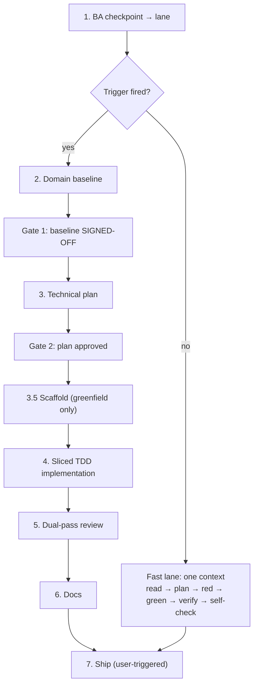

# Pipeline Detail — Two Lanes

> Reference for `AGENTS.md`. Read the section for the lane you are in, not the
> whole file. Lane rules and escalation triggers live in `AGENTS.md` §2 — this
> file does not restate them.



---

## Step 1 — Intake → lane

`intake-classifier` establishes outcome, affected behavior, scope, evidence,
material unknowns and observable acceptance before implementation. Reuse answered
questions and existing AC. Fast applies to bounded confirmed behavior with no
T1–T7 trigger; read-only research does not recurse through implementation BA.

Announce the lane once, with the trigger when escalating. A user override is
recorded, never silently applied.

## Fast lane (default)

Steps 1 → 4 → 5 (self-check) → 7. One context, no feature folder, no subagents.

1. **Read before writing** — the files named by the request, their tests, and the
   relevant `CONTEXT.md` terms. Stop when the exact files to change are known.
2. **Plan in ≤ 5 lines** in chat: files, approach, tests, risk.
3. **Red** — failing test or reproduction, run it.
4. **Green** — minimal implementation, run the focused test.
5. **Verify** — the repo's test/lint/typecheck for the touched area. No invented
   tooling; if no runner exists, say so.
6. **Self-check** against the same buckets the reviewer uses: `SECURITY`,
   `SPEC_FIDELITY`, `RELIABILITY`. No separate reviewer context.
7. **Close** — one Conventional Commit, only when the user asked.

`test-plan.md` is written only when the task needs more than three test cases.
`baseline.md`, `00-intake.md`, `CHANGELOG.md`, and `context-pack.md` do not exist
in this lane.

Escalate mid-task only when a trigger fires (see `AGENTS.md` §2): announce, create
the feature folder, record the trigger, continue from Step 2. One-way.

## Step 2 — Domain Baseline (Full lane)

Six sub-stages, scoped to material gaps in existing signed-off evidence. Do not
repeat answered interviews or manufacture documents for irrelevant pillars.

**2a. `elicitation-interview`** — interactive gate. 2–3 questions per batch across
the six pillars: RBAC, state machine, business rules/formulas, workflows/edge
cases, data & privacy, UX/NFRs. Anchor on roadmap AC; never re-ask what the AC
settles. Record answers and `ASM-` ids in `01-elicitation.md`. Never invent a
business rule.

**2b. `domain-modeling`** — includes gap analysis. Produces AS-IS / TO-BE, RBAC
matrix, Mermaid state diagrams, numbered `BR-<SLUG>-###`, ERD, NFRs. Syncs
`CONTEXT.md` and records load-bearing decisions in `adr/`.

**2c. `risk-contradiction-scanner`** — checks business logic contradictions,
state deadlocks, backward compatibility and scope. Builds the `RISK-` register,
consolidates `ASM-` entries and confirmed MoSCoW boundaries. This does not run
technical analysis on spec/plan/tasks that do not yet exist.

**2d. `spec-writer`** — ONE `requirements.md` with four sections instead of four
separately-authored documents:

```
requirements.md
├── 1. Business context   (BRD-level: problem, value, scope)
├── 2. Product behaviour  (PRD-level: flows, states, edge cases)
├── 3. Requirements       (SRS-level: REQ-<SLUG>-### with "Derived from")
└── 4. User stories       (US-<SLUG>-### with Given-When-Then + edge cases)
```

Every `REQ-` carries a **Derived from** pointer to a `BR-` or `ASM-` id.

> **Naming — do not confuse the two.** `requirements.md` is *what and why* (this
> stage). `spec.md` is *how* — DTOs, contracts, schema — and belongs to
> `technical-spec` in Step 3. Never write `spec.md` from here.

**Rendering, not re-authoring.** The four sections map 1:1 onto the classic four
documents, so splitting is an export step. Default: do not split. Render
`exports/BRD.md`, `exports/PRD.md`, `exports/SRS.md`, `exports/user-stories.md`
**only** when at least one holds:

- an external party reads it (client, auditor, vendor);
- each artifact needs its own signature;
- it is imported into a requirements tool (Jira, DOORS, Polarion);
- a contract or standard names the document.

Every export carries a `GENERATED FROM ../requirements.md — DO NOT EDIT BY HAND`
header, is regenerated wholesale, and never carries content the source lacks.
Framing may differ per audience; ids and facts may not.

**2e. `spec-validator`** — adversarial IEEE 29148 check, 8 criteria per REQ/US,
builds the traceability matrix against `requirements.md`. Loops back to 2d on
failure. Hard cap: 2 loops.

**2f. `handover`** — verifies exit gates, obtains explicit user approval, marks `baseline.md` as
`SIGNED-OFF v1.0`, and appends a **Dev Handover Brief** section to the same file.
No separate brief file. Records whether audience exports were rendered, and for whom.

> **Gate 1**: no technical spec and no code before `baseline.md` is SIGNED-OFF.

## Step 3 — Technical Plan (Full lane)

`technical-spec` → `implementation-plan` → `task-breakdown` →
`technical-consistency-review`. Review technical consistency only once all three
artifacts exist. Apply versioning and DTO contracts when relevant; supporting
models/contracts are optional and scope-driven. Apply `codebase-design`: minimal public
interfaces, hidden implementation, no shallow pass-through wrappers.

> **Gate 2**: user approves `plan.md` + `tasks.md`.

## Step 3.5 — Scaffold (Full lane, greenfield only)

`scaffold-architecture` runs **only when the repo has no established structure**
(no entry module, no layer convention). For an existing codebase, skip it — follow
the existing layout. When it does run, ask the user to pick one blueprint: C4
Layered, Hexagonal, or Feature-Based. Record the choice in `adr/ADR-ARCH-001`.

## Step 4 — Sliced TDD Implementation (Full lane)

`implementation-orchestrator` decomposes into vertical slices
(Data → Logic → API → UI) and delegates each slice with **scoped excerpts only**,
through `context-pack.md`.

- One developer per cohesive slice (Data+Logic+API together, UI separately).
- Never split a slice into four micro-subagents.
- Dispatch **independent slices in parallel**; serialize only on real data
  dependencies. The slice plan must mark which slices are parallel-safe.
- `code-explorer` runs only when the affected files cannot be named directly.
- `build-resolver` handles type/compile errors; `diagnosing-bugs` handles flaky or
  non-obvious failures.

TDD loop: `test-plan.md` (map `US-` → `TC-###`) → Red → Green → Refactor.

## Step 5 — Review (Full lane)

`code-reviewer` runs a **2-pass** review:

- Pass A — standards & security (injection, secrets, authz, type safety, async).
- Pass B — spec fidelity (`REQ-`/`BR-` coverage, state transitions, `CONTEXT.md`
  vocabulary).

**Pass C (lean / anti-overengineering) runs only when the diff exceeds 300
lines.**

Stopping rules are non-negotiable:

1. Hard cap of 3 rounds; round 4 never happens automatically.
2. Rounds 2–3 review the incremental diff only.
3. Findings grouped into 5 buckets (`SECURITY`, `SPEC_FIDELITY`, `RELIABILITY`,
   `ARCHITECTURE`, `LEAN`), pattern-level deduplication.
4. Stable finding IDs; `[RESOLVED]` / `[STILL OPEN]` / `[NEW]` / `[ACCEPTED]`
   state tracking. Never re-report a resolved or accepted finding.

`ui-ux-reviewer` runs **only when the diff touches UI files**
(`.tsx .jsx .css .scss .html .vue .svelte`).

> **Bug Severity Gate**: zero unresolved `Critical` findings.

## Step 6 — Docs (Full lane)

`tech-doc-architect` writes `docs/features/<slug>/README.md` and updates the
feature index. Update `docs/architecture/` + an ADR only when the feature changes
architecture (new entity, service, or contract).

`user-guide-with-screenshots` runs **per release, not per feature**.

`agent-evaluator` is **not** part of the default delivery path. Run it via
`/retro` when you want a meta-review of the workflow itself.

## Step 7 — Ship (both lanes, user-triggered only)

`/command-git-push`. Modular commits by layer: `docs(spec)` → `feat(shared-types)`
→ `feat(api)` → `feat(ui)` → `docs`.

**No autonomous rebase.** If the branch diverged, stop and report the conflict
instead of auto-resolving it. Single-line English Conventional Commits.
