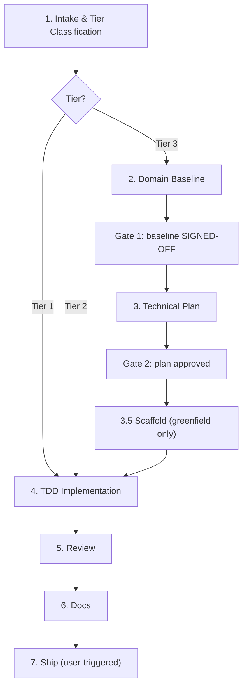

# Pipeline Detail — 7 Steps, Merged Stages

> Reference for `AGENTS.md`. Read the section for the step you are executing,
> not the whole file.



---

## Step 1 — Intake & Tier Classification

Entry point for every request. `intake-classifier` picks the lane from measurable
signals, not from vibes.

| Tier | Signal | Ceremony | Token budget |
| --- | --- | --- | --- |
| **1 — Fast-track** | < 80 lines, bug fix, typo, single config | none: reproduce → failing test → fix → verify → one commit | ≤ 20k |
| **2 — Lean task** | 80–250 lines, roadmap story with AC, not marked `[!]` | `test-plan.md` → TDD → review | ≤ 80k |
| **3 — Full feature** | > 250 lines, new core entity, cross-cutting auth/billing, or `[!]` | full domain baseline + plan | ≤ 250k |
| **Spike** | research question | note only, no feature folder | ≤ 15k |

If a run exceeds its budget by > 50 %, stop and report before continuing.

## Step 2 — Domain Baseline (Tier 3 only)

Six sub-stages, down from eight. Merges are deliberate: each merge removes one
full re-read of the same artifact.

**2a. `elicitation-interview`** — MANDATORY interactive gate. Pause and ask the
user 2–3 questions per batch across the six pillars: RBAC, state machine,
business rules/formulas, workflows/edge cases, data & privacy, UX/NFRs. Record
answers and `ASM-` IDs into `01-elicitation.md`. Never invent a business rule.

**2b. `domain-modeling`** — now includes gap analysis (previously a separate
stage with the same inputs). Produces AS-IS / TO-BE, RBAC matrix, Mermaid state
diagrams, numbered `BR-<SLUG>-###`, ERD, NFRs. Syncs `CONTEXT.md` and records
load-bearing decisions in `adr/`.

**2c. `consistency-scan`** — merged `risk-contradiction-scanner` +
`speckit-analyze`. One pass that looks for logic contradictions, state
deadlocks, backward-compatibility breaks, and spec/plan drift. Builds the
`RISK-` register, consolidates `ASM-` entries, locks MoSCoW scope including an
explicit Won't-Have list.

**2d. `spec-writer`** — writes ONE `requirements.md` with four sections instead of
four separately-authored documents:

```
requirements.md
├── 1. Business context   (BRD-level: problem, value, scope)
├── 2. Product behaviour  (PRD-level: flows, states, edge cases)
├── 3. Requirements       (SRS-level: REQ-<SLUG>-### with "Derived from")
└── 4. User stories       (US-<SLUG>-### with Given-When-Then + edge cases)
```

Every `REQ-` carries a **Derived from** pointer to a `BR-` or `ASM-` id.

> **Naming — do not confuse the two.** `requirements.md` is *what and why* (this
> stage). `spec.md` is *how* — DTOs, contracts, schema — and belongs to
> `speckit-specify` in Step 3. Never write `spec.md` from here.

**Rendering, not re-authoring.** The four sections map 1:1 onto the classic four
documents, so splitting is an export step. Default: do not split. Render
`exports/BRD.md`, `exports/PRD.md`, `exports/SRS.md`, `exports/user-stories.md`
**only** when at least one holds:

- an external party reads it (client, auditor, vendor);
- each artifact needs its own signature;
- it is imported into a requirements tool (Jira, DOORS, Polarion);
- a contract or standard names the document.

Every export carries a `GENERATED FROM ../requirements.md — DO NOT EDIT BY HAND`
header, is regenerated wholesale, and never carries content the source lacks.
Framing may differ per audience; ids and facts may not.

**2e. `spec-validator`** — adversarial IEEE 29148 check, 8 criteria per REQ/US,
builds the traceability matrix against `requirements.md`. Loops back to 2d on
failure. Hard cap: 2 loops.

**2f. `handover`** — verifies exit gates, marks `baseline.md` as
`SIGNED-OFF v1.0`, and appends a **Dev Handover Brief** section to the same file
(previously a separate document). No separate brief file. It also records whether
audience exports were rendered, and for whom.

> **Gate 1**: no code and no technical spec before `baseline.md` is SIGNED-OFF.

## Step 3 — Technical Plan

`speckit-specify` → `speckit-plan` → `speckit-tasks`. Enforce `/api/v1/...`
versioning and structured DTO contracts. Apply `codebase-design`: minimal public
interfaces, hidden implementation, no shallow pass-through wrappers.

> **Gate 2**: user approves `plan.md` + `tasks.md`.

## Step 3.5 — Scaffold (greenfield only)

`scaffold-architecture` runs **only when the repo has no established structure**
(no entry module, no layer convention). For an existing codebase, skip it —
follow the existing layout instead. When it does run, ask the user to pick one
blueprint: C4 Layered, Hexagonal, or Feature-Based. Record the choice in
`adr/ADR-ARCH-001`.

## Step 4 — TDD Implementation

`implementation-orchestrator` decomposes into vertical slices
(Data → Logic → API → UI) and delegates each slice with **scoped excerpts only**.

Slice count by tier:

- Tier 1 — no slicing, single developer turn.
- Tier 2 — cohesive slicing: one developer handles Data+Logic+API, one handles UI.
  Do **not** split into four micro-subagents.
- Tier 3 — four slices by dependency layer.

TDD loop: `test-plan.md` (map `US-` → `TC-###`) → Red → Green → Refactor.

`code-explorer` runs only when the orchestrator cannot determine the affected
files itself (unfamiliar repo, cross-cutting change). Otherwise the orchestrator
scopes directly and skips it.

`build-resolver` handles type/compile errors; `diagnosing-bugs` handles flaky or
non-obvious failures.

## Step 5 — Review

`code-reviewer` runs a **2-pass** review by default:

- Pass A — standards & security (injection, secrets, authz, type safety, async).
- Pass B — spec fidelity (`REQ-`/`BR-` coverage, state transitions, `CONTEXT.md`
  vocabulary).

**Pass C (lean / anti-overengineering) runs only when the diff exceeds 300
lines.** Small diffs do not need a third sweep.

Stopping rules are non-negotiable:

1. Hard cap of 3 rounds; round 4 never happens automatically.
2. Rounds 2–3 review the incremental diff only.
3. Findings grouped into 5 buckets (`SECURITY`, `SPEC_FIDELITY`, `RELIABILITY`,
   `ARCHITECTURE`, `LEAN`), pattern-level deduplication.
4. Stable finding IDs; `[RESOLVED]` / `[STILL OPEN]` / `[NEW]` / `[ACCEPTED]`
   state tracking. Never re-report a resolved or accepted finding.

`ui-ux-reviewer` runs **only when the diff touches UI files**
(`.tsx .jsx .css .scss .html .vue .svelte`). A backend-only change skips it
entirely.

> **Bug Severity Gate**: zero unresolved `Critical` findings.

## Step 6 — Docs

`tech-doc-architect` writes `docs/features/<slug>/README.md` and updates the
feature index. Update `docs/architecture/` + an ADR only when the feature changes
architecture (new entity, service, or contract).

`user-guide-with-screenshots` runs **per release, not per feature**. Accumulate
UI changes and generate the visual guide once per release batch. A single
feature with a UI tweak does not justify a Playwright screenshot run.

`agent-evaluator` is **not** part of the default delivery path. Run it via
`/retro` when you want a meta-review of the workflow itself.

## Step 7 — Ship (user-triggered only)

`/command-git-push`. Modular commits by layer: `docs(spec)` → `feat(shared-types)`
→ `feat(api)` → `feat(ui)` → `docs`.

**No autonomous rebase.** If the branch diverged, stop and report the conflict to
the user instead of auto-resolving it. Single-line English Conventional Commits.
