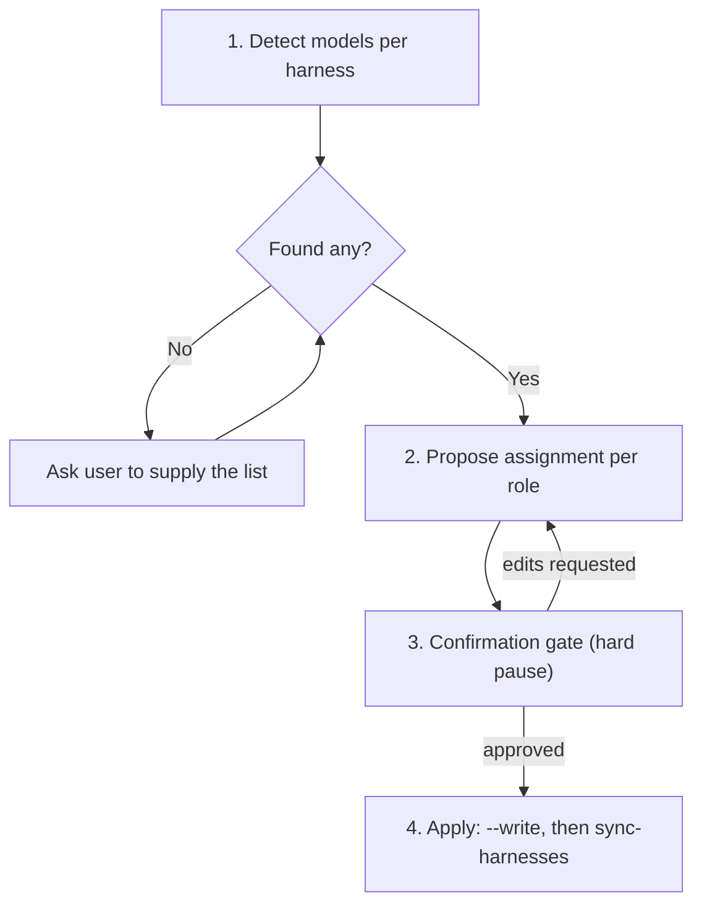

# Setup Subagents — model assignment by role

## Purpose

Prevents two opposite failures: paying reasoning-model prices for a mechanical
build-fix loop, and running a spec author on the cheapest model. Both are invisible
until the bill or the bug arrives.

**This skill proposes. It does not decide.** The user confirms before anything is
written.

## Non-negotiable constraint

`validate-agents.py` rejects any `model:` other than `inherit` in
`.agents/agents/*.md`. Never write a model id there. Ids go **only** into
`.agents/models/profiles.json`, which the harness sync reads to generate adapters.

```
.agents/agents/*.md        model: inherit        (portable, committed)
.agents/models/profiles.json  opus | sonnet | …  (resolved, generated)
.claude/agents/*.md        model: opus           (adapter, generated)
```

## Loop



### 1. Detect

```bash
node .agents/scripts/detect-models.mjs
```

Reports, per harness: presence, evidence path, models with a confidence level, and
whether detection was blocked.

| Confidence | Means | Trust |
| --- | --- | --- |
| `config` | Read from a settings file | Declared, entitlement unverified |
| `env` | From an env var | Declared for this shell only |
| `documented` | Part of the harness contract (e.g. routing values) | Reliable |
| `alias` | Documented CLI alias (opus/sonnet/haiku) | Exists, entitlement unverified |
| `manual` | Supplied by the user | Treat as authoritative |

**What detection cannot do:** prove entitlement. A model can appear in config and
still be refused by the account. That is why every proposal carries a confidence
and why step 3 exists.

### 2. Propose

The script maps each of the 13 roles to a tier from `.agents/models/capabilities.json`,
then to the best available model of that class.

Tier logic — **the tier follows the verification net, not perceived importance**:

| Tier | Rule | Roles |
| --- | --- | --- |
| `reasoning` | Nothing downstream catches a mistake | `business-analyst`, `system-architect`, `code-reviewer`, `ui-ux-reviewer`, `agent-evaluator` |
| `standard` | Tests and review are the safety net | `backend-developer`, `frontend-developer`, `slice-implementer`, `tech-doc-architect` |
| `fast` | Output is self-verifying (compiler, test runner) | `code-explorer`, `build-resolver`, `e2e-runner`, `user-guide-creator` |

A row marked `⚠` means no model of the intended class exists; the script fell back
to the nearest class. Say so explicitly — do not hide the downgrade.

### 3. Confirmation gate — HARD PAUSE

Present the table, then **stop**. Do not run `--write` in the same turn.

Ask exactly these three things:

1. Are any of these models wrong or unavailable to you?
2. Do you want a cheaper/stronger choice for any specific agent?
3. Apply now, or save the proposal without applying?

If the user edits the mapping, re-render the affected rows before applying.

### 4. Apply

```bash
node .agents/scripts/detect-models.mjs --write    # writes .agents/models/profiles.json
node .agents/scripts/sync-harnesses.mjs           # regenerates adapters
```

Then report which harnesses got concrete ids and which stayed on `inherit`.

## Failure handling

| Situation | Response |
| --- | --- |
| **No model detected at all** | Do not invent a list. Print the three options (run with `--models`, read the GUI dropdown, or keep everything on `inherit`) and wait. |
| **GUI-only harness** (Cursor, Windsurf, Copilot) | Detection is impossible by design — no config file to read. Ask the user to read the model dropdown and pass it via `--models`. |
| **Restricted entitlement** | A 403/denied model must be dropped from the proposal, not downgraded silently. Ask which models actually work. |
| **Harness has no subagents** (Copilot) | Skip it. Its row in `profiles.json` stays empty; nothing to assign. |
| **Stale capability table** | If `verifiedAt` in `capabilities.json` is older than ~90 days, say so before presenting. |
| **A tiny local model appears** (…2b, …7b) | Classified `tiny` and **never auto-proposed** — too small for multi-step tool calling. Surface it in the warnings; only use it if the user explicitly pins it in that agent's frontmatter. |

## Boundaries

- ❌ Writing a model id into `.agents/agents/*.md` — validator rejects it, harnesses drop the agent.
- ❌ Applying without an explicit yes.
- ❌ Presenting a `⚠` fallback as a normal recommendation.
- ❌ Inventing model names when detection returns nothing.
- ❌ Recommending `reasoning` for `build-resolver` "because it is smarter" — that is the most-iterated loop.
- ✅ Downgrade order when budget is tight: `agent-evaluator` → `ui-ux-reviewer` → `tech-doc-architect` → dev agents. Never `code-reviewer` first.

## Output format

```markdown
## <Harness label>

| Agent | Vai trò | Tier | Model | Vì sao |
| --- | --- | --- | --- | --- |
| `business-analyst` | Phỏng vấn & đặc tả | reasoning | `opus` | <reason> |
| `backend-developer` | Viết code backend | standard | `sonnet` | <reason> |
| `build-resolver` | Sửa lỗi build | fast | ⚠ `sonnet` | <reason + why downgraded> |

> <harness-specific caveat>

## Cần bạn xác nhận
- <blocked harnesses, low-confidence ids, stale table>

## Bước tiếp theo
1. Sửa chỗ nào sai · 2. Xác nhận · 3. `--write` · 4. `sync-harnesses`
```

## Verification

- [ ] Every present harness appears in the output, including blocked ones.
- [ ] Every `⚠` row has a stated reason.
- [ ] No file was written before the user's explicit approval.
- [ ] After apply: `node .agents/scripts/validate-agents.py` still reports 0 errors.
- [ ] `profiles.json` contains no model the user did not confirm.
