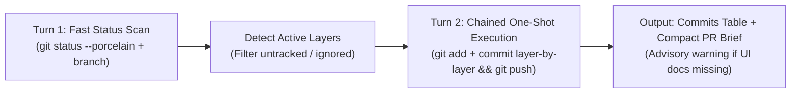

# Command: Fast Git Commit & Push Workflow (/command-git-push)

High-speed, token-efficient command skill for staging, creating **Modular Conventional Commits**, pushing to the active branch, and generating a GitHub PR Brief — **executed in 2 tool calls maximum**.

---

## Execution Workflow (2-Turn One-Shot Protocol)



---

### Step 1: Rapid Status & Active Layer Discovery (Turn 1)

1. Execute a single combined command:
   ```bash
   git status --porcelain && git branch --show-current
   ```
2. If working tree is clean (no modified or staged files), notify user: _"Working tree clean. Nothing to commit."_ and exit immediately.
3. **Respect Ignored & Scratch Files**:
   - Never stage `.gitignore` patterns, untracked scratch files (`brain/`, `.env*`, `.DS_Store`), or files under ignored workflow directories.
   - **Active Branch Principle**: Always commit changes directly onto the active `CURRENT_BRANCH`. Do not auto-stash or switch branches unless explicitly requested by the user.

---

### Step 2: Polyglot Modular Layering (Only Changed Layers)

Group only the files that **actually changed** into logical, independent commit layers.
**Rule:** If a layer has no modified files, skip it. If all changes belong to a single layer or a small task (< 80 lines), produce **1 clean conventional commit**.

| Layer                                      | Domain & Path Patterns (Polyglot)                                                                              | Conventional Commit Template                              |
| :----------------------------------------- | :------------------------------------------------------------------------------------------------------------- | :-------------------------------------------------------- |
| **Layer 1: Specs & Planning**              | `.specify/**`, `specs/**`, `docs/spec/**`, `test-plan.md`                                                      | `docs(spec): add specification and test plan for <topic>` |
| **Layer 2: Types, Contracts & Migrations** | `*/types/**`, `*/models/**`, `*/schemas/**`, `packages/shared*/**`, `prisma/migrations/**`, `db/migrations/**` | `feat(types): update contracts and schema for <topic>`    |
| **Layer 3: Backend & Core Services**       | `apps/api/**`, `backend/**`, `src/backend/**`, `internal/**`, `services/**`, `controllers/**`, `server/**`     | `feat(api): implement <topic> services and endpoints`     |
| **Layer 4: Frontend Web & UI**             | `apps/web/**`, `frontend/**`, `src/frontend/**`, `src/components/**`, `ui/**`, `client/**`                     | `feat(web): implement <topic> UI components and views`    |
| **Layer 5: Documentation & Roadmap**       | `docs/**`, `README.md`, `CHANGELOG.md`, `PRODUCT_BACKLOG_ROADMAP.md`                                           | `docs: update documentation, changelog, and roadmap`      |
| **Layer 6: Chores & Configs**              | `.agents/**`, `package.json`, lockfiles, tool configs, dotfiles                                                | `chore: update configurations and tool dependencies`      |

> [!IMPORTANT]
> **Single-Line English Commit Rules:**
>
> - Strictly single-line, imperative mood, under 72 characters: `<type>(<scope>): <subject>`.
> - No trailing period, no `\n`, no Markdown backticks inside the commit message string.

---

### Step 3: One-Shot Chained Execution & Smart Push (Turn 2)

Execute all git additions, commits, and the remote push in a **single chained bash invocation (`&&`)** to eliminate tool-call latency and context token churn:

```bash
# Example composite execution (adapt paths and messages based on actual changed layers):
git add <Layer-1-files> && git commit -m "docs(spec): ..." && \
git add <Layer-2-files> && git commit -m "feat(types): ..." && \
git add <Layer-3-files> && git commit -m "feat(api): ..." && \
git push origin <CURRENT_BRANCH>
```

#### Smart Remote Push & Rebase Handling:

- Attempt: `git push origin <CURRENT_BRANCH>`.
- If rejected due to remote updates (`non-fast-forward`):
  ```bash
  git pull --rebase origin <CURRENT_BRANCH> && git push origin <CURRENT_BRANCH>
  ```
- **Merge Conflicts**: If rebase conflict markers occur, stop and alert user with `git diff --name-only --diff-filter=U`. Never force-push (`--force`) without user instruction.

---

### Step 4: Non-Blocking Advisory & Compact PR Brief

After successful push, output a concise status and ready-to-copy PR Brief in GitHub markdown:

1. **Non-Blocking UI User Guide Advisory**:
   - If changes modified frontend UI files (`web/`, `frontend/`, `components/`) and `docs/user-guides/<slug>.md` has not been updated with screenshots:
     > 💡 **Advisory Notice:** UI changes committed. If this completes a customer-facing flow, remember to run `/command-user-guide <slug>` to capture Playwright screenshots before merging. _(Push completed successfully — this does not block your work)._

2. **Generated PR Brief (English)**:

````markdown
### 🚀 Push Succeeded on `<branch-name>`

| Commit Hash | Layer   | Message                                      |
| :---------- | :------ | :------------------------------------------- |
| `abc1234`   | Backend | `feat(api): add export endpoints for orders` |
| `def5678`   | Docs    | `docs: update changelog and roadmap`         |

---

#### 📋 Ready-to-Copy Pull Request Brief

```markdown
## What & Why

[Brief 1-2 sentence description of what this PR accomplishes and why]

## Key Changes

- **[Layer/Scope]**: [Specific change bullet point]

## Verification

- [x] Automated test suite passed
- [x] Conventional commits verified
- [ ] User guide updated (if user-facing UI change)
```
````

```

```
