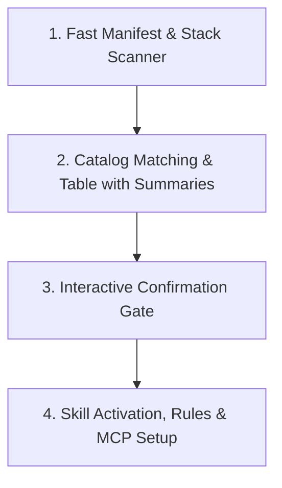

# Command: Adaptive Project Setup (/skill-setup)

This command skill automatically inspects the target codebase, detects active programming languages, frameworks, ORMs, and container tools, matches them against the **Curated Skill Catalog** ([.agents/catalog.json](../../../catalog.json)), and presents an interactive selection table with a **concise summary** for each skill before activation.

---

## 4-Step Execution Loop



---

### Step 1: Fast Manifest & Stack Scanner

Scan the project root directory to identify technology detection markers with zero excessive token reading overhead:

1. **Programming Languages**:
   - Flutter / Dart: `pubspec.yaml`, `*.dart`, `.flutter-plugins`
   - Swift / Apple: `Package.swift`, `project.yml`, `*.xcodeproj`, `*.xcworkspace`, `*.swift`
   - Go: `go.mod`, `main.go`
   - Python: `pyproject.toml`, `requirements.txt`, `Pipfile`, `poetry.lock`, `setup.py`
   - Rust: `Cargo.toml`
   - TypeScript/Node: `tsconfig.json`, `package.json`
2. **Frameworks & Libraries**:
   - NestJS: `nest-cli.json`, `@nestjs/core` string in `package.json`
   - React / Next.js: `next.config.*`, `"react"` or `"next"` string in `package.json`
   - Tailwind CSS: `tailwind.config.*`, `"tailwindcss"` string in `package.json`
3. **Databases & DevOps**:
   - Prisma: `prisma/schema.prisma`
   - PostgreSQL: `"postgres"` string in `docker-compose.yml`, `package.json` (`pg`), or `requirements.txt` (`psycopg2`)
   - Docker: `Dockerfile`, `docker-compose.yml`, `compose.yaml`
4. **Git System & Code Intelligence**:
   - Check `.git/` directory to prepare for `code-review-graph` MCP Server.

---

### Step 2: Match Catalog & Display Table with Concise Summaries

Read [.agents/catalog.json](../../../catalog.json). For each entry matching the scan results from Step 1, extract:

- **Skill / Tool Name (`name`)**
- **Category (`category`)**
- **Recommendation Level (`recommendation`)**: `Recommended` or `Optional`
- **Concise Summary (`short_description`)**: A succinct 1–2 sentence explanation of the skill's concrete value.

#### Mandatory Output Format:

The Agent **MUST** display a clean, visual Markdown table to the user following this format:

```markdown
### 🔍 Project Tech Stack Analysis:

- **Primary Language(s)**: [e.g., TypeScript / Go]
- **Frameworks**: [e.g., React, Next.js, Tailwind]
- **Database & DevOps**: [e.g., PostgreSQL, Docker]

### 📦 Recommended Skills & Tooling:

| Skill / Tool          | Category     | Status            | Concise Summary                                                                                                                                                        |
| :-------------------- | :----------- | :---------------- | :--------------------------------------------------------------------------------------------------------------------------------------------------------------------- |
| **go-patterns**       | Language     | 🎯 Recommended    | Enforces Go idioms: internal/ package boundaries, minimal consumer-defined interfaces, structured error wrapping, and anti-anemic domain models.                       |
| **go-rules**          | Language     | 🎯 Recommended    | Coding standards for Go: naming conventions, concurrency safety, table-driven unit testing, and defer cleanup rules.                                                   |
| **go-depguard**       | Boundary     | 🎯 Recommended    | Golangci-lint boundary checker configuration preventing unauthorized cross-package imports and keeping domain packages isolated.                                       |
| **docker-patterns**   | DevOps       | 🎯 Recommended    | Production container standards: distroless base image, non-root user, multi-stage caching, and healthcheck.                                                            |
| **code-review-graph** | Intelligence | 💡 Optional (MCP) | Builds local Tree-sitter + SQLite code graph allowing subagents (code-explorer, code-reviewer) to query caller/callee and blast-radius with up to 26x token reduction. |
```

> [!NOTE]
> If no technology markers match (for example, an unsupported stack), the agent informs the user that no optional language skills are required, keeping the project 100% clean with zero unused skill directories.

---

### Step 3: Interactive Confirmation Gate

Reuse explicit selections and Git tracking mode already confirmed in this session or project metadata. Ask only for missing choices using direct questions or interactive chat:

1. **Confirm activation of recommended skills**:
   - The user can accept all, or request to drop/add specific skills from the catalog.
2. **Activate `code-review-graph` MCP Server**:
   - Ask user: _"Would you like to activate the `code-review-graph` MCP Server to enable subagents to analyze function/class call graphs and reduce token usage during reviews?"_
3. **Git Management Mode for Universal Agents Workflow in this project**:
   - Ask user how they wish Git to handle the workflow files:
     - **🌐 1) Team Mode (Shared)**: Track all in Git to share rules, skills, and configs with the team on GitHub/GitLab (no additions to `.gitignore`).
     - **🔒 2) Local-Only Mode (Private)**: Automatically add `.agents/`, `.specify/`, `CONTEXT.md`, and rules to `.gitignore` to keep the remote repo 100% clean.
     - **🕶️ 3) Stealth Mode (Private Local)**: Add workflow files to `.git/info/exclude` (leaves the repository's `.gitignore` untouched).
     - **⚖️ 4) Hybrid Mode (Shared Docs, Private Engine)**: Track `CONTEXT.md`, `adr/`, `.specify/` in Git; ignore `.agents/` and rules in `.gitignore`.

---

### Step 4: Activation & Injection

Once confirmed by the user, the agent performs automated setup:

1. **Activate selected catalog mappings through the update engine**:
   - Resolve a verified workflow source checkout from `.agents/workflow-source.json` (`sourcePath`) or a source checkout supplied by the user. Verify it contains `.agents/scripts/update-engine.py` and `optional-stack-skills/catalog.json`; if unavailable, obtain that checkout before activation. Never guess a global source directory.
   - Match each explicitly approved non-MCP choice to its exact catalog `source_path` and `target_path`. Keep skill destinations in the catalog's **cold** `.agents/skill-library/` tier; do not promote them into `.agents/skills/`. Rules and configs retain their own catalog destinations.
   - Run the verified source engine with `--sync`, `--source`, `--target`, and `--extra-ship` containing only approved `source_path=target_path` mappings (comma-separated). Do not use `--detect-packs` to add unapproved choices or `--ship` to replace the core install set.
     ```bash
     # Example only: substitute verified absolute source/target paths and approved mappings.
     python3 /verified/uaw/.agents/scripts/update-engine.py --sync \
       --source /verified/uaw --target /project \
       --extra-ship 'optional-stack-skills/languages/go/go-patterns=.agents/skill-library/engineering/go-patterns,optional-stack-skills/languages/go/rules/coding-style.md=.agents/rules/go-coding-style.md'
     ```
   - The engine records `selectedPacks`, source-to-target mappings and **last-written** hashes in `.agents/workflow-source.json`, then regenerates index, adapters and hooks. Never copy packs manually or edit the registry/hash state to adopt existing files. `--yes` keeps conflicts; it does not authorize overwriting user changes.
   - Inspect the engine exit status and derived-phase report. Retained custom files, unavailable packs, conflicts or failed generators must be reported accurately; do not claim every requested pack was activated when it was kept or unavailable. The target receives selected files, not the source `optional-stack-skills/` tree.
2. **Project-local `code-review-graph` MCP (only if selected)**:
   - Check the existing `uvx` executable. If absent, report the prerequisite and obtain approval for any dependency installation; do not install globally as part of pack activation.
   - Merge only the selected server into the project's supported MCP configuration, preserving existing servers. Do not run an auto-installer that rewrites other projects or global harness settings.
     ```json
     {
       "mcpServers": {
         "code-review-graph": {
           "command": "uvx",
           "args": ["code-review-graph", "serve"],
           "type": "stdio"
         }
       }
     }
     ```
   - Run `uvx code-review-graph build` in the target project only when its runtime is available and the selected setup authorizes fetching it. Report a failed build as incomplete.
3. **Configure Git Tracking Mode (based on Step 3 selection)**:
   - **Local-Only Mode**: Append the following block to `.gitignore`:
     ```gitignore
     # --- Universal Agents Workflow (Local-Only Mode) ---
     .agents/
     .specify/
     adr/
     CONTEXT.md
     GEMINI.md
     CLAUDE.md
     AGENTS.md
     .cursorrules
     .windsurfrules
     ```
   - **Stealth Mode**: Append the block above to `.git/info/exclude` to keep `.gitignore` untouched.
   - **Hybrid Mode**: Append the following block to `.gitignore`:
     ```gitignore
     # --- Universal Agents Workflow (Hybrid Mode: Private Engine) ---
     .agents/
     GEMINI.md
     CLAUDE.md
     AGENTS.md
     .cursorrules
     .windsurfrules
     ```
   - **Team Mode**: Only ignore temporary log files: `.agents/scripts/hooks/*.log`.
4. **Update `CONTEXT.md`**:
   - Populate detected tech stack, frameworks, and package managers in the **Components & Services Overview** table in `CONTEXT.md`.
5. **Completion Notification**:
   - Report the list of successfully activated skills.
   - Report the applied Git tracking mode.
   - Suggest the next action (e.g., run `/continue` or initiate Phase 1 BA pipeline via `intake-classifier`).
