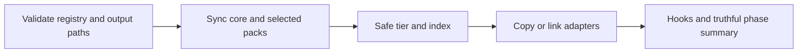

# Safe pack/adapter updates and source cleanup

**Type:** Technical reference. **Date:** 2026-11-26.
**Status:** Implemented and verified; independent Round 2 APPROVE.

## Behaviour

Core and explicitly selected packs share validated mappings and last-written
SHA-256 baselines for fresh install, reinstall and apply. Customized/unverified
files remain; kept hashes never advance. Copy adapters update per file, symlinks
retain ownership checks, and index/hooks follow the same preservation rule.

## CLI and state

From a source checkout, run `bash install.sh --target /path/to/project --mode team`.
For a local engine sync: `python3 .agents/scripts/update-engine.py --sync --source
/path/to/source --target /path/to/project --yes`. Optional explicit mapping:
`--extra-ship optional-stack-skills/languages/go/go-patterns=.agents/skill-library/engineering/go-patterns`.
Update/apply reuses stored selections; it never auto-detects additional packs.

Workflow metadata schema 2 keeps selected IDs/mappings, mapping-bound fileHashes,
protected paths and per-phase outcomes. Harness output provenance lives in
harness-manifest.json; index/hooks have separate derived-state files. These are
project-local files, excluded from distribution. No API/database/UI was added.

## Source consolidation

Removed 26 redundant/app-specific files, 4,096,850 bytes. Keep the general
screenshot script, generic plan/template and bundled Archify JSON/renderers.
The optional Archify wrapper points to canonical resources. Catalog authority is
optional-stack-skills/catalog.json; .agents/catalog.json is its generated runtime
mirror. Source maintenance checks use build-skill-index.mjs --catalog-check;
--catalog-write explicitly regenerates the mirror.

## Verification and recovery

See [acceptance report](acceptance-report.md), [test plan](test-plan.md) and
[cleanup inventory](implementation/cleanup-inventory.json). Requirements and
approved design remain in [requirements](requirements.md) and [spec](spec.md).

Partial phases may follow successful safe copies: inspect lastSync/console
results and retry after resolving prerequisites. Do not delete metadata to adopt
custom files. Marker-only or legacy state grants no overwrite/delete permission.
Existing customer artifacts removed from upstream remain in place. There is no
global transaction/automatic Git rollback, global configuration or dependency
installation. PowerShell runtime remains unverified on this host (pwsh absent).
